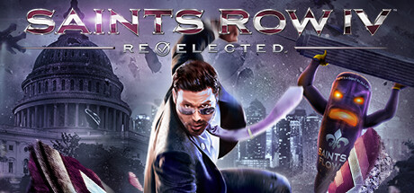

**Saints Row IV is the gleefully absurd superhero action game where the President of the United States gains alien superpowers inside a Matrix-like simulation and battles an intergalactic invasion with their gang. Features unlimited traversal powers and massive weapon variety.**

---

## 📖 About

Saints Row IV is the gleefully absurd superhero action game where the President of the United States gains alien superpowers inside a Matrix-like simulation and battles an intergalactic invasion with their gang. Features unlimited traversal powers and massive weapon variety.

## ⚠️ Problems Without Trainer

| Problem | Status |
|---------|--------|
| **Power Unlocking** — Sim Powers unlock slowly via collectible alien cluster farming | ✅ Solved |
| **Challenge Completion** — Getting all gold medals on activity challenges requires mastery | ✅ Solved |
| **Super Power Balancing** — Sprint and jump powers make vehicles nearly obsolete | ✅ Solved |
| **DLC Content** — Some notable content gated behind separate paid packs | ✅ Solved |

## ✅ Solution

The **Saints Row IV Trainer** solves all these issues by giving you complete control over the game.

## 🎯 Full Feature List

- Unlimited Resources
- God Mode / Invincibility
- Instant Skill Cooldown
- One-Hit Kill
- Freeze Game Timer
- Unlock All Items & Achievements
- Custom Speed Multiplier
- Save State Anywhere

## 🚀 Quick Start

1. **Disable Windows Defender** temporarily (trainer may trigger false positive)
2. Download the trainer from the button above
3. Launch Saints Row IV
4. Run the trainer as Administrator
5. Activate desired cheats with hotkeys

## 💎 Free vs Paid

| Feature | Free | Pro |
|---------|------|-----|
| Basic God Mode | ✅ | ✅ |
| Unlimited Resources | ✅ | ✅ |
| All Advanced Cheats | ❌ | ✅ |
| Auto-Updates | ❌ | ✅ |
| Priority Support | ❌ | ✅ |

## 💻 Requirements

- Windows 10/11 (64-bit)
- Saints Row IV (any version)
- .NET Framework 4.8+
- DirectX 11+

## 🍎 macOS

macOS users can use our alternative tool:

## ⚖️ Legal

This trainer is for educational and single-player use only. Use responsibly.

---

